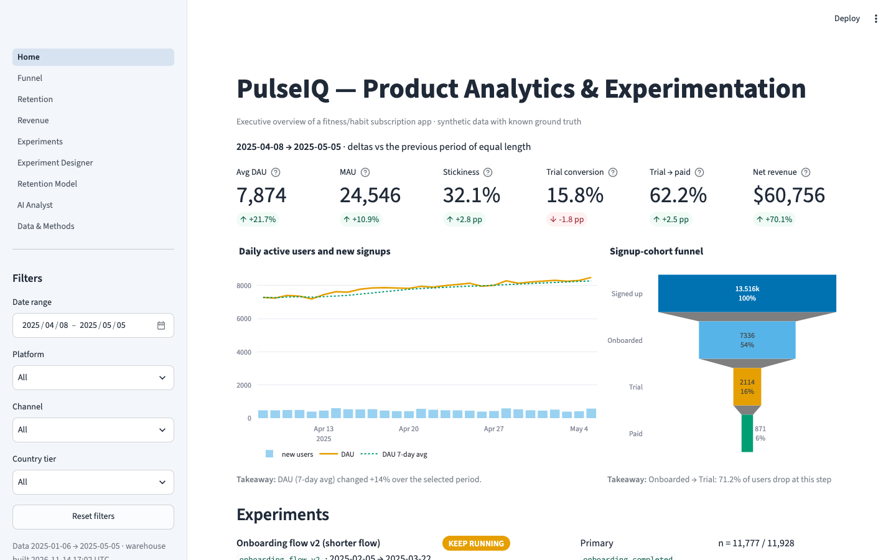
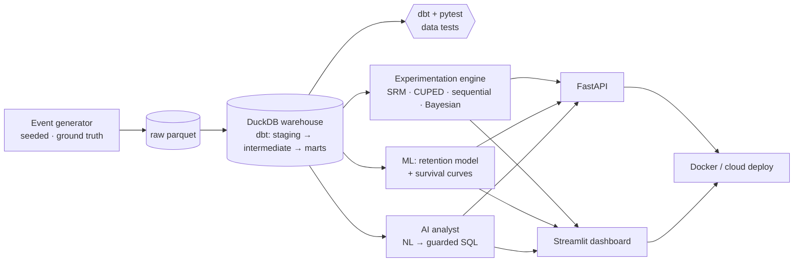

# PulseIQ — Product Analytics & Experimentation Platform

**An open-source product analytics & experimentation platform: event pipeline, validated A/B testing
engine, retention ML, and an AI analyst.**

[](https://github.com/ajain023-tech/ProductAnalytics/actions/workflows/ci.yml)




## What it does

Teams ship features based on A/B readouts they can't fully trust. PulseIQ simulates a fitness/habit
subscription app with **known ground truth**, then shows that its whole analytics stack gets the
right answers:

- **Event pipeline:** a seeded generator produces 60,000 users and about 7 million events, with
  realistic dirt (duplicates, clock skew). A **DuckDB + dbt** warehouse cleans them into tested
  marts (22 models, 70 data tests).
- **Validated experimentation engine:** SRM checks, CUPED, Holm/BH corrections, always-valid
  sequential tests, Bayesian readouts, power analysis and a SHIP / KEEP RUNNING / INVESTIGATE
  decision. It recovers every planted effect and catches a planted assignment bug (numbers below).
- **Retention ML that actually works:** a leakage-tested 72-hour feature set, a time-based split,
  calibrated gradient boosting, PR-AUC far above baseline, and survival curves. v1 reported 85 %
  accuracy by predicting that nobody is retained.
- **AI analyst:** plain-English questions become JSON plans and **guarded** SQL (sqlglot
  allow-list, read-only connection, timeout). It has an offline mode and a 25-question eval set.
- **Product layer:** a FastAPI service and a 9-page Streamlit dashboard share one service layer.
  Docker, CI, and one-command rebuilds of every number.

## Key results

<!-- RESULTS:START -->
<!-- generated by scripts/render_results.py from artifacts/ - do not edit by hand -->

| Result | Value |
|---|---|
| Planted experiment effects recovered inside the engine's 95 % CI | **12 / 12** |
| SRM flagged only on the experiment with the planted bug, localised to Android | **yes** |
| CUPED CI-width reduction on `paywall_redesign` | **34.1%** (variance −56.7%) |
| A/A false-positive rate: fixed horizon / naive peeking / mSPRT | 5.2% / **28.7%** / 1.3% |
| D30 retention model PR-AUC (test) vs majority baseline | **0.484** vs 0.153 (heuristic 0.303) |
| Model recall at the validation-chosen threshold (v1: 0.000) | **0.704** |
| Planted retention drivers in the model's top 5 features | **all 3** |
| Cox hazard ratio for setting a reminder in the first 72 h | 0.494 |
| AI analyst eval (25 questions, `mock` provider): correct / SQL valid / refusals | 100% / 100% / 100% |

| Experiment | Decision | Primary lift [95 % CI] | SRM p |
|---|---|---|---:|
| `onboarding_flow_v2` | **KEEP RUNNING** | +2.81 pp [+1.54 pp, +4.07 pp] | 0.33 |
| `paywall_redesign` | **SHIP** | +2.81 pp [+1.66 pp, +3.96 pp] | 0.47 |
| `streak_reminder` | **INVESTIGATE** | +0.54 pp [-0.64 pp, +1.72 pp] | 3.2e-06 |
<!-- RESULTS:END -->

Every number above is inserted by `scripts/render_results.py` from files in `artifacts/`;
`make check-numbers` fails if the README drifts from them.

## Architecture



1. **Generate:** the generator writes raw parquet plus `ground_truth.json`. Only the validation
   code ever reads the truth file.
2. **Build:** dbt builds the staging, intermediate and mart layers and runs the data tests.
3. **Analyse:** the experiment engine and the ML pipeline read the marts and write their
   artifacts.
4. **Serve:** the API, the dashboard and the AI analyst call one shared service layer.

## Quickstart

**Docker** (API on :8000, dashboard on :8501; uses the small dataset by default):

```bash
docker compose up --build
# full-size data (needs ~5 GB RAM):  PULSEIQ_SIZE=full docker compose up --build
# port 8000 busy?  PULSEIQ_API_PORT=8010 docker compose up --build
```

**Local** (Python 3.11):

```bash
python3.11 -m venv .venv && source .venv/bin/activate
make install      # pip install -e ".[dev]"
make all          # generate 60k users -> dbt build -> analyse -> train -> validate -> tests  (~2 min)
make serve        # API + Swagger at http://localhost:8000/docs
make dashboard    # http://localhost:8501
pulseiq ask "Which acquisition channel has the best D7 retention?"
```

For a ~10-second run, use `make all-small`. The AI analyst works offline. To use an LLM, set
`PULSEIQ_LLM_PROVIDER` and a key (see [docs/AI_ANALYST.md](docs/AI_ANALYST.md)).

## Tech stack

Python 3.11 · pandas · NumPy · DuckDB · dbt-duckdb · SciPy · statsmodels · scikit-learn · lifelines
· SHAP · FastAPI · Streamlit · Plotly · sqlglot · pydantic · Typer · pytest · ruff · Docker ·
GitHub Actions

## Repository structure

```text
ProductAnalytics/
├── src/pulseiq/
│   ├── generator/      seeded event simulator + ground truth
│   ├── warehouse/      dbt build wrapper, DuckDB connection
│   ├── experiments/    SRM, CUPED, frequentist, sequential, Bayesian, power, decisions, reports
│   ├── ml/             72 h features, time split, models, evaluation, explainability, survival
│   ├── ai/             catalog, prompts, LLM clients, SQL guard, agent, offline mode, evals
│   ├── services/       business logic shared by API and dashboard
│   ├── api/            FastAPI app
│   ├── validation.py   compares results with ground truth (only reader of the truth file)
│   └── cli.py          `pulseiq generate | build | analyze | train | survival | validate | serve | ask | ai-eval`
├── warehouse/          dbt project: staging → intermediate → marts, tests, macros
├── apps/dashboard/     Streamlit: Home + 8 pages, components
├── tests/              pytest (generator, warehouse, stats, truth, leakage, ML, API, dashboard, AI guard)
├── scripts/            bootstrap, benchmark, screenshots, results renderer, number checks
├── docs/               methodology, model card, demo kit, career kit, roadmap + progress log
├── legacy/             the original v1 analysis (kept intact)
├── Dockerfile · docker-compose.yml · Makefile · pyproject.toml · .github/workflows/ci.yml
```

## Methodology

- [Event schema](docs/EVENT_SCHEMA.md) · [Data generation & ground truth](docs/DATA_GENERATION.md) ·
  [Warehouse](docs/WAREHOUSE.md) · [SQL migration](docs/SQL_MIGRATION.md)
- [Experimentation engine](docs/EXPERIMENTATION.md) · [Retention ML](docs/ML_RETENTION.md) ·
  [Model card](docs/MODEL_CARD.md) · [AI analyst](docs/AI_ANALYST.md)
- [Deployment](docs/DEPLOYMENT.md) · [Final audit](docs/FINAL_AUDIT.md) ·
  [Progress log](docs/roadmap/PROGRESS.md)

## Why synthetic data?

Real product data never tells you the *true* effect of an experiment, so you can't prove an A/B
engine is right. PulseIQ plants the truth:
- a +3 pp onboarding effect, a −0.5 pp paid-conversion harm and a +8 % trial lift;
- a logging bug that drops Android treatment users;
- habits that genuinely cause retention.

It then checks that the engine's confidence intervals cover those values, that the SRM is caught
and localised, and that the model rediscovers the drivers. The generator is calibrated to the
headline rates of the original (v1) dataset to within ±3 pp
(`artifacts/reports/legacy_vs_generated.md`). The data is fake on purpose; the methods are
validated because of it.

## Limitations & future work

- The data is simulated: no real users, and no real event ingestion.
- Future work:
  - streaming ingestion with Kafka or Redpanda;
  - dbt on BigQuery or Snowflake;
  - a feature store and drift monitoring;
  - authentication and multi-tenancy;
  - a React frontend;
  - uplift modelling for targeting retention campaigns.
- The AI analyst's free-form quality has only been measured offline. A real-LLM eval run is
  pending an API key.
- The full-size dataset needs about 5 GB of RAM to generate, so the hosted demo uses the small
  dataset, where experiments are underpowered.

## v1 → v2

v1 was a well-documented student analysis of one 11,462-row CSV, with BigQuery results that
couldn't be reproduced and retention models whose recall was 0. It is preserved in
[`legacy/`](legacy/README.md). v2 (PulseIQ) rebuilt it as a reproducible platform. See
[CHANGELOG.md](CHANGELOG.md).

## Author

**Anushka Jain** · GitHub: [ajain023-tech](https://github.com/ajain023-tech) · LinkedIn: TBD · Tableau: TBD

## License

[MIT](LICENSE)
