# Warehouse: DuckDB + dbt

`pulseiq build` runs `dbt build` (all models, then all data tests) on the dbt
project in `warehouse/`. It writes a single DuckDB file,
`data/warehouse/pulseiq.duckdb`. dbt runs in a subprocess, and the raw-data and
warehouse paths are passed in through `PULSEIQ_RAW_DIR` and `PULSEIQ_WAREHOUSE`.
`warehouse/profiles.yml` is committed because it contains no secrets.

```mermaid
flowchart LR
  subgraph raw[raw parquet - source]
    U[users] & E[events] & S[sessions] & A[experiment_assignments] & SU[subscriptions] & I[invoices] & X[experiments]
  end
  subgraph stg[staging]
    sU[stg_users] & sE[stg_events] & sS[stg_sessions] & sA[stg_assignments] & sSU[stg_subscriptions] & sI[stg_invoices] & sX[stg_experiments]
  end
  subgraph int[intermediate]
    W[int_data_window] & F72[int_user_first_72h] & DA[int_user_daily_activity] & DN[int_user_day_n_activity] & OS[int_onboarding_steps] & SP[int_subscription_periods]
  end
  subgraph marts
    DU[dim_users] & FE[fct_events] & FF[fct_funnel_user] & AFD[agg_funnel_daily] & AFS[agg_funnel_by_segment] & RC[agg_retention_cohorts] & RD[fct_revenue_daily] & K[agg_kpis_daily] & XE[fct_experiment_exposures]
  end
  raw --> stg --> int --> marts
```



## Layers

- **Staging (`stg_*`)**: one model per source. Renames, casts and light cleaning:
  dedupe events on `event_id`, drop clock-skewed events, fill missing platform,
  parse the JSON properties, and derive `country_tier` and `day_n`.
- **Intermediate (`int_*`)**: reusable building blocks that aren't meant for end
  users, such as the 72 h feature table, the activity grids and billing periods.
- **Marts**: the tables that the dashboard, the API, the experiment engine, the ML
  code and the AI analyst read.

## Mart grains (one sentence each)

| Mart | Grain |
|---|---|
| `dim_users` | one row per user, with dimensions and lifecycle timestamps (onboarded, trial, paid, last active) |
| `fct_events` | one row per cleaned event, enriched with user dimensions |
| `fct_funnel_user` | one row per user, with ordered funnel flags and timestamps (signup → onboarded → trial → paid) |
| `agg_funnel_daily` | one row per signup date |
| `agg_funnel_by_segment` | one row per segment type × value (channel, platform, country tier, device tier) |
| `agg_retention_cohorts` | one row per weekly signup cohort × day N (1, 3, 7, 14, 30), eligibility-aware |
| `fct_revenue_daily` | one row per calendar date (gross, refunds, net, MRR, active subscriptions, ARPDAU, ARPPU) |
| `agg_kpis_daily` | one row per calendar date (DAU, WAU, MAU, stickiness, new users, conversions, revenue) |
| `fct_experiment_exposures` | one row per user × experiment: variant, segments, pre-period covariates and every outcome |

## Key definitions

- **Day N** is the 24 h block `[signup_ts + N·24h, signup_ts + (N+1)·24h)`.
  **DN retention** means at least one session started in that block.
- **Eligibility**: a user is in the day-N denominator only if
  `signup_ts + (N+1) days ≤ data_end`. Immature cohort cells have
  `retention_rate = null`, not zero. A user who signed up 5 days ago cannot be in
  the D7 denominator.
- `data_end` (exclusive) is taken from the data itself: midnight after the last raw
  event (`int_data_window`).
- **Ordered funnel**: a stage counts only if the previous stage happened first, as
  in v1 `02_funnel.sql`.
- **MRR**: the monthly-equivalent price (annual ÷ 12) of paid periods that cover the
  end of the day. A refund or cancellation ends the period early.

## `fct_experiment_exposures` — the Phase 2 contract

| Column | Meaning |
|---|---|
| `experiment_id`, `user_id`, `variant` | key + arm (control/treatment) |
| `assigned_at`, `test_end` | exposure start; `min(experiment end_date, data_end)` |
| `signup_ts`, `assigned_at_signup` | true for new-user experiments randomised at signup (no pre-period) |
| `platform`, `acquisition_channel`, `country_tier`, `device_tier` | segments for SRM localisation / HTE |
| `pre_sessions_14d`, `pre_active_days_14d` | sessions / active dates in `[assigned_at − 14 d, assigned_at)` (CUPED covariates) |
| `onboarding_completed` | ever completed onboarding |
| `trial_eligible`, `trial_started_14d` | signup + 14 d observed; trial within 14 d of signup |
| `paid_eligible`, `paid_30d` | signup + 30 d observed; paid within 30 d of signup |
| `d1/d7/d30_eligible`, `d1/d7/d30_retained` | exact-day retention with eligibility |
| `trial_started_in_test`, `paid_in_test`, `refund_in_test` | 0/1 within `[assigned_at, test_end)` |
| `sessions_in_test`, `net_revenue_in_test` | counts / net USD in the test window (mean metrics) |

Always filter on the matching `*_eligible = 1` flag before computing a rate.

## Tests

`dbt build` runs about 70 data tests after the models are built, and fails the
build on any error.

- `unique` and `not_null` on every primary key; `unique_combination` (macro in
  `warehouse/macros/`) on composite keys.
- `relationships`: events → users, sessions → users, assignments → users and
  experiments, invoices → subscriptions, subscriptions → users, fct_events → dim_users.
- `accepted_values`: event_name, platform, channel, device tier, country tier,
  variant, plan, status.
- Singular tests in `warehouse/tests/`: no event before signup, funnel
  monotonicity, retention rates in [0, 1], cohort denominators non-increasing in N,
  and net = gross − refunds (both daily and as a total against invoices).

`tests/test_warehouse.py` also builds the small warehouse in a temp directory. It
checks that dedupe removed exactly the planted duplicates and clock-skew rows, and
that warehouse retention equals an independent pandas calculation.

## Running

```bash
pulseiq generate --small && pulseiq build    # ~2 s
pulseiq profile                              # row counts + headline KPIs
# dbt docs and lineage graph:
cd warehouse && PULSEIQ_RAW_DIR=../data/raw PULSEIQ_WAREHOUSE=../data/warehouse/pulseiq.duckdb \
  dbt docs generate --profiles-dir . && dbt docs serve --profiles-dir .
```

## DuckDB vs BigQuery

DuckDB is an in-process columnar OLAP engine: no server, a single file, and fast
enough for millions of events on a laptop. That makes it ideal for a reproducible
project that CI rebuilds from scratch. In production the same dbt project would
target BigQuery or Snowflake by changing the profile. SQL differences are small:
`date_diff` argument order, `QUALIFY` works in both, and `SAFE_DIVIDE` becomes
`x / nullif(y, 0)`.
