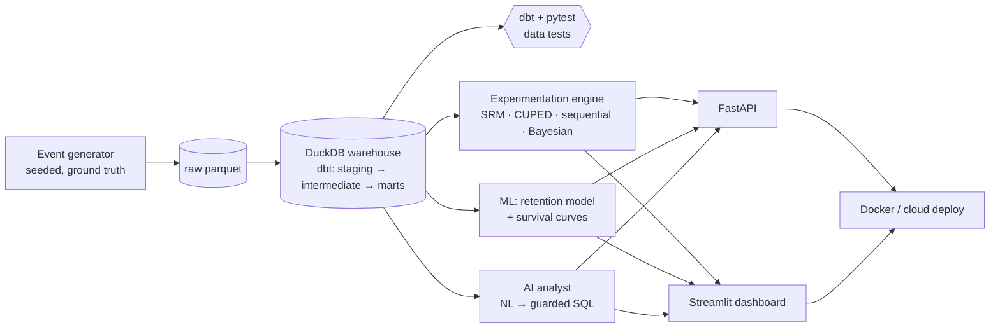

# PulseIQ — 7-Day Upgrade Roadmap

> **What this folder is:** four self-contained build specs, one per phase, written as
> prompts for Claude (Claude Code or Claude in the desktop app). Each phase doc tells
> Claude *what* to build, *why*, *how to verify it*, and *when to stop*. You (Anushka)
> review, run the acceptance checks, learn the concepts listed at the end of each doc,
> and move to the next phase.

## The upgrade in one paragraph

Today, ProductAnalytics is a well-documented student analysis of one 11,462-row
user-level CSV (binary flags only — no events, no channel/platform/country, numbers that
can't be reproduced because the BigQuery source isn't in the repo). **PulseIQ** turns it
into a small but real **product analytics & experimentation platform**: a reproducible
event-data generator with *known ground truth*, a DuckDB + dbt warehouse with tested
models, an experimentation engine (SRM checks, CUPED variance reduction, sequential /
Bayesian readouts) that is *proven correct* by recovering the planted effects, a
leakage-free retention model that actually works, a FastAPI service, a multipage
Streamlit dashboard, an **AI analyst** that answers product questions in plain English
with guarded SQL, and a one-command Docker deploy.

## Why this is resume / industry / hackathon grade

| Signal recruiters & judges look for | Where PulseIQ shows it |
|---|---|
| Reproducibility | `make all` rebuilds every number from a seed; CI runs it |
| Data engineering | Event schema, DuckDB warehouse, dbt staging → marts, data tests |
| Statistical rigor | SRM, CUPED, sequential testing, Bayesian, power analysis, validated against planted truth |
| ML done honestly | No leakage, time-based split, PR-AUC, calibration, model card |
| Software engineering | Python package, typed, tested, linted, API, Docker, CI |
| GenAI with guardrails | NL → SQL analyst, read-only, SELECT-only, row limits, eval set |
| Demo-ability | Live dashboard + Swagger + 3-minute demo script |

## Schedule (1 week)

| Day | Phase | Doc | Outcome |
|---|---|---|---|
| 1–2 | **1. Foundation** | [PHASE_1_FOUNDATION.md](PHASE_1_FOUNDATION.md) | Package, event generator, DuckDB + dbt warehouse, tests, CI, repo cleanup |
| 3–4 | **2. Experimentation & ML** | [PHASE_2_EXPERIMENTATION_ML.md](PHASE_2_EXPERIMENTATION_ML.md) | Experiment engine that recovers planted effects; working retention model |
| 5–6 | **3. Product layer & AI** | [PHASE_3_PRODUCT_API_AI.md](PHASE_3_PRODUCT_API_AI.md) | FastAPI, multipage dashboard, AI analyst |
| 7 | **4. Ship** | [PHASE_4_SHIP.md](PHASE_4_SHIP.md) | Docker, live deploy, README, demo script, resume bullets, viva prep |

If you fall behind, every phase has a **"Cut list"** section saying what to drop first
without breaking later phases.

## How to run a phase with Claude

1. Open the repo in Claude Code (or connect the folder in the Claude app).
2. Paste this prompt, swapping the phase number:

   ```text
   Read docs/roadmap/README.md and docs/roadmap/PHASE_1_FOUNDATION.md in full.
   Execute Phase 1 end to end, following the doc exactly. Work autonomously:
   make reasonable decisions inside the doc's constraints and record them in
   docs/roadmap/PROGRESS.md instead of asking me. Stop and ask me ONLY for the
   items the doc lists under "Stop and ask". When finished, run every acceptance
   check, paste their output into PROGRESS.md, and give me a short summary.
   ```

3. Review the summary, run the acceptance commands yourself, and read the
   "Learn this" section before you move on.

## Rules that apply to every phase (Claude: obey these always)

1. **Never invent numbers.** Every metric in docs, README, dashboard or resume
   bullets must come from a file the pipeline generated. If a number isn't produced
   yet, write `TBD (generated in Phase N)`.
2. **Work on a branch per phase**: `phase-1-foundation`, `phase-2-exp-ml`,
   `phase-3-product-ai`, `phase-4-ship`. Small commits with clear messages
   (`feat(warehouse): add stg_events model`). Merge to `main` only when the phase's
   acceptance checks pass.
3. **Don't delete history.** Move superseded files to `legacy/` with `git mv`; never
   `rm` the user's work. (File deletion may be blocked in this environment anyway.)
4. **Keep `docs/roadmap/PROGRESS.md` updated** — create it in Phase 1. For each phase
   log: date, what was built, decisions made and why, deviations from the doc,
   acceptance-check output, known issues, and what the next phase must know.
5. **Python 3.11+**, `ruff` for lint + format, `pytest` for tests, type hints on
   all public functions, docstrings on modules and public functions.
6. **Pin dependencies** in `pyproject.toml` (with `requirements.txt` exported for
   Streamlit Cloud). Prefer pure-Python / wheel-available packages. If a package
   won't install, use the fallback named in the phase doc and log it.
7. **Secrets** only through environment variables (`.env` git-ignored, `.env.example`
   committed). Never commit a key.
8. **Determinism:** one global seed (`PULSEIQ_SEED`, default `42`). Re-running the
   pipeline must reproduce identical outputs.
9. **Small data by default.** The full dataset must build in < 3 minutes on a laptop;
   provide a `--small` mode (< 20 s) for CI and cloud deploys.
10. **When the doc and reality disagree** (a file is different from what the doc
    expects), trust the repo, adapt sensibly, and log the deviation.

## Target architecture (end of Phase 4)



## Target repo layout (end of Phase 4)

```text
ProductAnalytics/
├── src/pulseiq/              # the Python package (all logic lives here)
│   ├── config.py
│   ├── generator/            # synthetic event simulator
│   ├── warehouse/            # DuckDB connection + build helpers
│   ├── experiments/          # SRM, CUPED, sequential, Bayesian, power
│   ├── ml/                   # features, training, evaluation, survival
│   ├── ai/                   # NL→SQL analyst + guardrails
│   ├── api/                  # FastAPI app
│   └── cli.py                # `pulseiq generate|build|analyze|train|serve`
├── warehouse/                # dbt project (models, tests, macros)
├── apps/dashboard/           # multipage Streamlit app
├── tests/                    # pytest suite
├── docs/                     # write-ups + roadmap/
├── legacy/                   # the original scripts, notebooks, app.py
├── data/                     # generated (git-ignored except tiny samples)
├── artifacts/                # generated models, reports (git-ignored)
├── Dockerfile, docker-compose.yml, Makefile, pyproject.toml
└── .github/workflows/ci.yml
```
